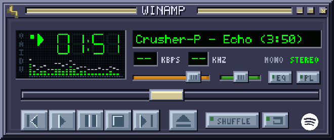

# Island Now

Lokales Spotify-Widget für OBS. Anmeldung im Browser mit OAuth 2.0 und PKCE, automatische Token-Erneuerung, Albumcover, Titel, Interpret, Fortschritt und transparente Browserquelle. Keine Abhängigkeit von Songify oder Textdateien. Version 1.2 ergänzt integrierte GitHub-Updates und automatische Release-Pakete. Die Anwendung zeigt Metadaten an und gibt keinen Ton aus.

## In fünf Schritten starten

1. ZIP **vollständig entpacken**, zum Beispiel nach `E:\STREAM\Bot\Island-Now`. Keine Dateien der früheren Songify-Lösung übernehmen.
2. Unter Windows wird eine vorhandene Node.js-Version ab 22 automatisch erkannt. Fehlt eine passende Version, richtet der Start sie selbst ein; dafür ist einmalig Internet erforderlich. Auf Mac/Linux [Node.js](https://nodejs.org/en/download) ab Version 22 installieren. Keine npm-Installation und keine zusätzlichen Pakete erforderlich.
3. **Island-Now.exe** aus dem Windows-Release doppelklicken. Bei einem Quellpaket zuerst **START-WINDOWS.cmd** ausführen; es erstellt die Tray-Anwendung einmalig mit dem Windows-.NET-Compiler. Danach läuft die Anwendung mit Symbol rechts unten im Infobereich. Die Oberfläche öffnet sich unter **http://127.0.0.1:17653**. Für weitere Starts direkt die erzeugte EXE verwenden.
4. Die Spotify-App wie unten beschrieben konfigurieren, die **Client-ID** eintragen und auf **Mit Spotify verbinden** klicken. Die Anmeldung erfolgt auf der Spotify-Seite.
5. Einen Titel in Spotify abspielen. **URL kopieren** drücken, in OBS eine **Browserquelle** hinzufügen und die URL einfügen. **Breite 800, Höhe 400**. „Lokale Datei“ bleibt aus. Ein bestehendes benutzerdefiniertes CSS, das einen Hintergrund setzt, entfernen; die Quelle ist bereits transparent.

## Windows-Tray und Aktualisierung

Ab Version 1.2.2 prüft der Windows-Start zuerst die Laufzeit. Ohne passende Systeminstallation lädt ein kleines Fortschrittsfenster die offizielle Node.js-LTS-Version für x64 oder ARM64 von `nodejs.org`. ZIP und EXE werden mit fest hinterlegten SHA-256-Werten geprüft. Nur `node.exe` und die Lizenz werden unter `runtime/` im entpackten Island-Now-Ordner abgelegt. Es sind keine Administratorrechte nötig; Windows-PATH wird nicht verändert. Der Ordner muss beschreibbar sein. Nach der einmaligen Einrichtung startet die App wie gewohnt im Tray. Bei Abbruch oder Downloadfehler einfach erneut starten; eine vorhandene Laufzeit wird erst nach erfolgreicher Prüfung ersetzt.

Im Windows-Release liegt `Island-Now.exe` bereits fertig bei. Beim Quellpaket wird sie durch den ersten Start erzeugt. Diese native Windows-Anwendung startet Node ohne Konsolenfenster. Ein Doppelklick auf das Tray-Symbol öffnet die Oberfläche. Das Kontextmenü enthält **Oberfläche öffnen**, **Neu starten**, **Protokoll öffnen** und **Beenden**. Nur „Beenden“ stoppt die Anwendung; das Schließen eines Browserfensters beendet das Widget nicht. Ein zweiter Start öffnet die Oberfläche statt eine zweite Tray-Instanz zu starten. Die lokale Node-Instanz erhält beim Beenden einen gezielten Shutdown-Befehl; auch der Verlust der Verbindung zum Tray-Prozess beendet den zugehörigen Server.

Für den manuellen Umstieg von Version 1.0 oder 1.1: die bisherige Instanz beenden. Neue Dateien in denselben Ordner entpacken bzw. kopieren und ersetzen. **Den bestehenden `.data`-Ordner behalten.** Darin liegen deine Anmeldung, Profile, Einstellungen und OBS-Links. Anschließend `START-WINDOWS.cmd` starten und die Browseroberfläche neu laden. In OBS einmalig die Browserquellen-Höhe auf **400 px** setzen. Eine selbst erzeugte `Island-Now.exe` aus der alten Quellversion muss durch die neue Release-EXE ersetzt oder vor dem erneuten Quellpaket-Start entfernt werden.

Das Protokoll liegt unter `.data/tray.log`. Die Konsolenvariante `START-KONSOLE.cmd` bleibt zur Diagnose verfügbar und benötigt Node im Windows-PATH. Der Mac-/Linux-Start verwendet weiterhin ein Terminal. Die private Windows-Laufzeit in `runtime/` bleibt bei App-Updates erhalten und gehört nicht ins weitergegebene ZIP.

## Integrierte Updates ab Version 1.2

Unter **Updates** prüft die Oberfläche auf Wunsch beim Öffnen das neueste stabile Release im konfigurierten GitHub-Projekt `BR3TZN/island-now`. Nach einer Bestätigung werden das Paket und seine Prüfsummen geprüft. Unter Windows wird die Anwendung über den Tray neu gestartet; Anmeldung und Einstellungen bleiben in `.data`. OBS lädt das Widget nach einem Versionswechsel neu. Während des Neustarts kann es kurz ausgeblendet sein.

Der GitHub-Release-Workflow und ein Windows-Publizierungsskript sind vorbereitet. Erst nach der Veröffentlichung ist das Projekt online erreichbar. Die vorherige Entwicklungs-ZIP 1.1 benötigt einmalig ein manuelles Update auf 1.2. [Veröffentlichung und spätere Releases](docs/RELEASES.md).

## Spotify-App einrichten

Das [Spotify Developer Dashboard](https://developer.spotify.com/dashboard) öffnen und eine vorhandene eigene App verwenden oder eine neue erstellen. Ein möglicher App-Name ist „Island Now“. Als Website kann die eigene Website dienen, zum Beispiel `https://www.danielkroiss.com`, oder die lokale Adresse, sofern das Dashboard sie akzeptiert. Bei der API-Auswahl **Web API** wählen.

Unter Settings diese Redirect-URI hinzufügen und speichern:

```text
http://127.0.0.1:17653/auth/callback
```

Die URI muss exakt passen: `127.0.0.1`, HTTP, Port 17653, `/auth/callback` und kein zusätzlicher Slash. `localhost` ist für Spotify-Redirects nicht zulässig. Die Oberfläche zeigt immer die zur laufenden Anwendung passende URI und hat einen Kopierknopf.

Die **Client-ID** aus dem Dashboard eintragen. Sie hat 32 Hex-Zeichen. **Client-Secret und Spotify-Passwort werden hier nicht benötigt.** Anschließend die Anmeldung im selben Browser abschließen. Erlaubt wird ausschließlich das Lesen des aktuell abgespielten Inhalts (`user-read-currently-playing`).

## Anzeige

- **Island, Studio, Compact, Cyberpunk, Forza, Winamp Classic:** sechs über die Oberfläche auswählbare Layouts. Cyberpunk verwendet kantige HUD-Flächen mit Gelb, Cyan und Magenta. Forza basiert auf deinem früheren `forza.css`: Cover oben, graue Textbalken, gelber Titel und weißer Interpret. Die empfohlene OBS-Höhe von 400 px verhindert Abschneiden des vertikalen Forza-Layouts.
- **Winamp Classic:** ersetzt den LINAMP-Look durch das klassische Player-Fenster im Seitenverhältnis 275 × 116. Pixel-Schrift, Segment-Uhr, goldene Titelzeilen und silberne Tasten orientieren sich an der Vorlage. Der Player zeigt Titel, Interpret und Zeit ohne Albumcover; Cover-Farben und Übergänge bleiben verfügbar. Pegelbalken und Tasten sind dekorativ. Nicht verfügbare Audioangaben bleiben „--“. Vorhandene LINAMP-Einstellungen und OBS-Links bleiben gültig.

  
- **Bei Songwechsel:** bei neuem Titel, beim Start der Browserquelle und beim Fortsetzen nach einer Pause für die gewählte Dauer eingeblendet; Standard 15 Sekunden.
- **Dauerhaft:** solange Wiedergabedaten vorliegen. „Bei Pause ausblenden“ lässt sich separat schalten.
- **Akzentfarbe, Breite, Cover, Fortschritt und Zeit:** direkt einstellbar. Einstellungen werden automatisch gespeichert und von OBS übernommen.
- **Demo / Live:** Demo funktioniert ohne Spotify. Die Gestaltungsvorschau bleibt sichtbar. „Einblendung testen“ demonstriert die gewählte Anzeigedauer; bei Live wird auch das echte OBS-Widget erneut eingeblendet.
- **Akzentfarbe aus Cover:** einschaltbare lokale Farbauswertung des aktuellen Covers. Die Akzentfarbe und bei Island auch die dezente Hintergrundtönung passen sich dem Album an. Dunkle Farben werden für die Lesbarkeit aufgehellt. Ohne auswertbares Cover gilt die manuelle Farbe als Fallback. Das Cover selbst bleibt unverändert. Die Funktion arbeitet auch bei ausgeblendeter Cover-Anzeige.
- **Bewegung des gesamten Widgets:** Dropdown mit Fade, von links/rechts/oben/unten, sanfter Skalierung oder direktem Ein-/Ausblenden.
- **Titel- und Coverwechsel:** eigenes Dropdown für Überblenden, seitliches Überblenden oder direktes Umschalten. Die Übergangsdauer ist zwischen 0,15 und 1,5 Sekunden einstellbar; Standard 0,65 Sekunden. Albumcover werden vor dem Wechsel geladen und mit zwei Ebenen überblendet. Schnelle Titelwechsel verwerfen überholte Übergänge.
- **Client-ID:** standardmäßig als Passwortfeld verdeckt, auch während der Eingabe. „Anzeigen“ blendet sie gezielt ein. Nach 15 Sekunden, bei Fensterwechsel, verstecktem Browser-Tab oder Profilwechsel wird sie automatisch wieder verborgen.
- **Lange Titel:** automatische Laufschrift, die durch die regelmäßigen Spotify-Abfragen nicht neu gestartet wird. Podcasts zeigen Episodentitel und Podcastname.
- **Kein aktiver Titel / Werbung / Fehler:** das OBS-Widget bleibt transparent. Fehlermeldungen erscheinen ausschließlich in der Bedienoberfläche.

Spotify kann auf deinem Gaming-PC, Handy oder einem anderen Gerät laufen. Das Widget fragt den aktuellen Titel des angemeldeten **Kontos** ab. Island Now muss auf dem **OBS-PC** laufen, damit die lokale Browserquelle erreichbar ist. Unter Windows darfst du die Browser-Oberfläche schließen; die Anwendung läuft im Tray weiter.

## Andere Personen und mehrere Konten

Jede Person kann dieses saubere ZIP auf ihrem eigenen PC starten, ihre eigene Client-ID eintragen und sich im Browser mit ihrem eigenen Spotify-Konto anmelden. Die Anwendung ist dafür vorbereitet; es muss kein Code geändert werden.

Alternativ kannst du deine Spotify-App für wenige freigeschaltete Konten verwenden: zusätzliche Spotify-Nutzer vor der Anmeldung unter **User Management / Users and Access** der App hinzufügen. In Island Now erzeugt das **+** neben dem Profilnamen weitere lokale Profile. Jedes Profil hat eigene Tokens, Einstellungen und eine eigene OBS-URL.

**Spotify-Vorgaben, Stand 16.10.2026:** Neue Development-Mode-Apps erlauben bis zu **fünf autorisierte Nutzer**. Der **App-Inhaber benötigt Premium**. Bestehende Kontingente können Bestandsschutz haben. Eine unbegrenzt nutzbare zentrale Anmeldung mit einer einzigen App erfordert eine entsprechende Freigabe von Spotify. Dieses ZIP umgeht diese Beschränkungen nicht.

Die vorliegende Version läuft lokal. Sie ist kein zentral gehosteter Mehrnutzer-Dienst und benötigt keine Portfreigabe. Die Browser-Anmeldung und getrennten Profile sind vollständig implementiert.

## Anmeldung und Daten

Zugangstokens werden rechtzeitig automatisch erneuert. Widerrufene oder abgelaufene Refresh-Tokens erfordern eine erneute Browser-Anmeldung. Spotify nennt für Dashboard-Apps derzeit eine Refresh-Token-Laufzeit von sechs Monaten; Erneuern des Zugangstokens verlängert diese nicht.

Anmeldedaten und Einstellungen liegen verschlüsselt im Ordner `.data`. Der Schlüssel liegt daneben; das schützt vor versehentlichem Klartext-Weitergeben, nicht vor Zugriff durch ein kompromittiertes Windows-Konto. **Den persönlichen `.data`-Ordner nicht mit anderen teilen.** Zum Weitergeben das ursprüngliche ZIP verwenden. Das Verzeichnis muss beschreibbar bleiben. Ein Backup oder Umzug muss den kompletten `.data`-Ordner samt Schlüssel umfassen.

„Verbindung trennen“ entfernt die lokalen Spotify-Tokens. Zum Widerrufen der Freigabe zusätzlich die App unter [Spotify Apps](https://www.spotify.com/account/apps/) entfernen. „Overlay-Link erneuern“ macht den bisherigen lokalen Widget-Link ungültig.

## Fehlerbehebung

| Problem | Ursache / Lösung |
| --- | --- |
| `INVALID_CLIENT` oder Redirect-Fehler | Client-ID und Redirect-URI exakt prüfen, im Dashboard speichern und Anmeldung neu starten. Kein `localhost`. |
| Login erfolgreich, trotzdem kein Titel / 403 | Zusätzlichen Nutzer in der App freischalten. Premium und App-Status des App-Inhabers prüfen. Richtigen Spotify-Account verwenden. |
| Overlay erscheint nur kurz | Standard ist „Bei Songwechsel“, 15 Sekunden. Für dauerhafte Anzeige „Dauerhaft“ wählen. |
| OBS bleibt transparent | Erst in der Oberfläche „Live“ prüfen. Spotify abspielen, Profil und URL prüfen, Tray-Symbol prüfen. Bei Pause und gestoppter Musik kann Transparenz beabsichtigt sein. |
| Cover fehlt bei lokalen Dateien | Spotify liefert für lokale Dateien nicht immer Cover und vollständige Metadaten. Ein Ersatzsymbol erscheint. |
| Oberfläche nach Neustart meldet Sitzung abgelaufen | Browserseite neu laden. Die Spotify-Anmeldung selbst bleibt gespeichert. |
| Port 17653 belegt | Bereits laufende Instanz unter der lokalen URL öffnen oder die andere Anwendung schließen. Nicht mehrfach starten. |
| Nach Standby kein aktueller Titel | Automatische Wiederverbindung abwarten; bei widerrufener Freigabe erneut verbinden. Nach Wiederaufnahme der Wiedergabe ggf. ein paar Sekunden auf Spotify warten. |
| Spotify begrenzt Anfragen / 429 | Die Anwendung respektiert `Retry-After` automatisch. Keine Refresh-Schleife starten. |
| Browser statt Oberfläche zeigt Quelltext / leere Seite | Über `START-WINDOWS.cmd` bzw. `Island-Now.exe` starten und die HTTP-Adresse öffnen, nicht `index.html` direkt. |
| Tray-Symbol nicht sofort sichtbar | Im Windows-Infobereich den Pfeil für ausgeblendete Symbole öffnen. Von dort lässt sich das Symbol dauerhaft in die sichtbare Leiste ziehen. |
| Tray-Erstellung schlägt fehl | ZIP vollständig in einen beschreibbaren Ordner entpacken. Windows 11 enthält .NET Framework 4.8.1. Der Start sucht den vorhandenen `csc.exe` im Framework-Ordner. Falls er auf dem PC fehlt, zeigt der Start eine Fehlermeldung; `START-KONSOLE.cmd` dient zur Diagnose. |

## Technischer Aufbau

Node.js ab 22, ausschließlich Node-Standardbibliothek, kein Build und keine npm-Abhängigkeiten. Server standardmäßig nur auf `127.0.0.1`. OAuth mit SHA-256-PKCE, einmaligem State, Browser-Bindung und zehn Minuten gültigem Anmeldeversuch. Keine Tokens im OBS-Link oder Browser-Storage. Gemeinsamer Abfrage-Cache, deduplizierte Token-Erneuerung, begrenzte Wiederholungen, Spotify-429-Backoff, Behandlung von 204/401/403 und verschlüsselte, atomare Speicherung. Cover und Metadaten werden aus Spotify übernommen und zu Spotify verlinkt.

```text
server.mjs         Lokaler HTTP-Server und OAuth-Callback
lib/               Spotify-Anbindung, Datenmodell und verschlüsselte Speicherung
public/            Bedienoberfläche und transparentes OBS-Widget
test/              Automatisierte Prüfungen mit simulierten Spotify-Antworten
windows/Tray.cs    Quellcode für die native Windows-Tray-Anwendung
```

Start im Terminal: `node server.mjs --open`. Tests: `npm test` oder `node --test`. Ein anderer Port kann über `ISLAND_PORT` gesetzt werden; dann die neue Redirect-URI im Dashboard registrieren und die neue URL in OBS verwenden. `ISLAND_DATA_DIR` erlaubt einen anderen lokalen Datenordner.

Der Tray-Starter verwendet Windows Forms / .NET Framework. Das Release-Workflow-Skript erstellt eine fertige EXE; bei Quellpaketen wird sie beim ersten Windows-Start lokal erstellt. In dieser Linux-Umgebung konnte die Windows-EXE nicht kompiliert oder ausgeführt werden.

Die automatisierten Tests simulieren Spotify. Eine echte Anmeldung kann erst nach Eintragen einer gültigen Client-ID und persönlicher Freigabe des Kontos geprüft werden.

## Offizielle Quellen

- [Spotify: Authorization Code with PKCE](https://developer.spotify.com/documentation/web-api/tutorials/code-pkce-flow)
- [Spotify: Redirect URIs](https://developer.spotify.com/documentation/web-api/concepts/redirect_uri)
- [Spotify: Quota modes und Nutzerfreigaben](https://developer.spotify.com/documentation/web-api/concepts/quota-modes)
- [Spotify: Änderungen im Development Mode 2026](https://developer.spotify.com/documentation/web-api/tutorials/february-2026-migration-guide)
- [Spotify: Refreshing tokens](https://developer.spotify.com/documentation/web-api/tutorials/refreshing-tokens)
- [Spotify: Currently playing](https://developer.spotify.com/documentation/web-api/reference/get-the-users-currently-playing-track)
- [Spotify: Rate limits](https://developer.spotify.com/documentation/web-api/concepts/rate-limits)
- [Spotify: Design & Branding](https://developer.spotify.com/documentation/design)
- [Microsoft: .NET Framework unter Windows](https://learn.microsoft.com/de-de/dotnet/framework/install/on-windows-and-server)
- [Microsoft: NotifyIcon](https://learn.microsoft.com/de-de/dotnet/api/system.windows.forms.notifyicon)
- [Microsoft: C#-Compileroptionen](https://learn.microsoft.com/dotnet/csharp/language-reference/compiler-options/)

Unabhängiges Projekt; keine offizielle Spotify-Anwendung. Keine Audiowiedergabe oder Übertragung von Musik enthalten.

## Farben der Bedienoberfläche

Oben unter **Oberfläche** zwischen **Neutral dunkel** und **Cover-Farben** wählen. Cover-Farben folgen dem aktuellen Titel des aktiven Spotify-Profils und wechseln weich. Ohne Cover bleibt die Oberfläche neutral. Vor der Anmeldung lässt sich der Effekt anhand des Demo-Covers ansehen. Die Auswahl wird in diesem Browser gespeichert und ist unabhängig von der Akzentfarbe des OBS-Widgets.
